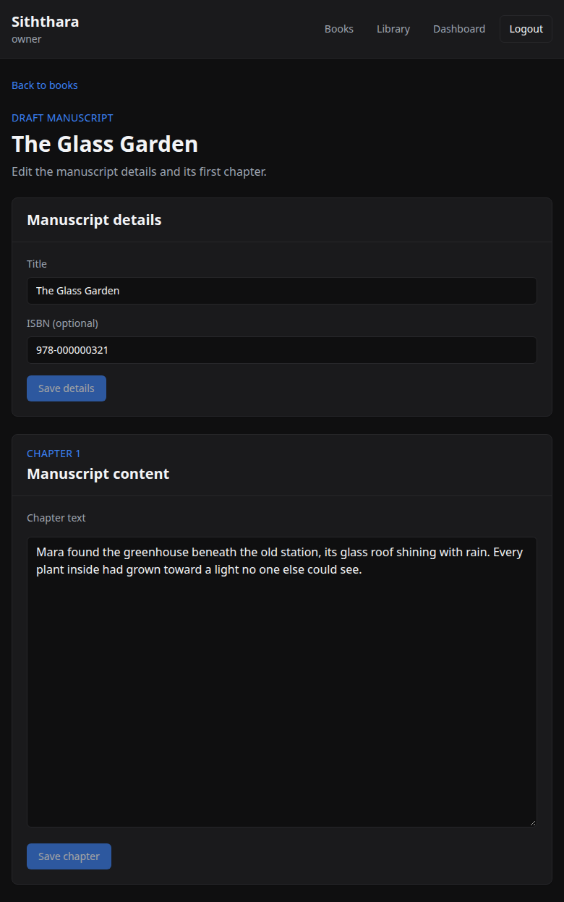

# Manuscript editor manual smoke check

The frontend currently has no automated test runner. Use this checklist with
the local auth and novels services running and a signed-in owner account.

The screenshot below shows the loaded editor with mocked API data.

1. Open `/books`, choose **New manuscript**, enter a title, optionally enter an
   ISBN, and create it. Confirm the editor opens at `/manuscripts/<novelId>`.
2. Change the title and ISBN, choose **Save details**, reload, and confirm the
   saved values remain.
3. Enter chapter text, choose **Save chapter**, reload, and confirm the text
   remains. Before the first chapter save, the editor should treat the chapter
   API's `404` as an empty chapter.
4. Sign in as a different user and open the same manuscript URL. Confirm the
   page shows **Access denied** and does not render editable fields.
5. With an owner session, make the novels API unavailable after the editor has
   loaded and attempt a save. Confirm the relevant save error is visible; restore
   the service and confirm the save can be retried.

The novels service currently keeps chapter bodies in memory, so a service
restart or a different service instance may lose them. Chapter discovery and
durable storage are tracked separately in novels issues #55 and #56.
